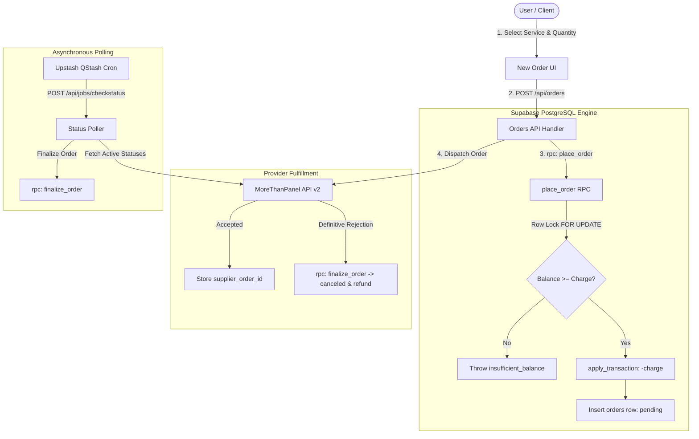

# LegitSMM 🚀

<div align=\"center\">

**High-Performance, Web3-Powered Social Media Growth Platform**

[](https://nextjs.org/)
[](https://react.dev/)
[](https://www.typescriptlang.org/)
[](https://supabase.com/)
[](https://tailwindcss.com/)
[](https://wagmi.sh/)

[Features](#-key-features) • [Architecture](#-system-architecture) • [Tech Stack](#-tech-stack) • [Getting Started](#-getting-started) • [Documentation](#-documentation)

</div>

---

## 🌟 Overview

**LegitSMM** is an enterprise-grade Social Media Marketing (SMM) reseller and growth infrastructure platform. Built on Next.js 16 App Router, React 19, and Supabase PostgreSQL, LegitSMM combines modern Web3 on-chain funding with wholesale provider automation, atomic double-entry ledger transactions, and automated order status reconciliation.

---

## ⚡ Key Features

- **🎯 Curated High-Retention Services:** Fine-grained service catalog for Instagram with transparent audience classification (**Organic**, **Mix**, **Bot**), speed ratings, start times, and guaranteed refill windows.
- **⚡ Atomic Single-Supplier Dispatch:** Hardcoded 1-to-1 supplier mapping per service with zero unstable fallback loops. Orders are atomically validated and charged via PostgreSQL row locks (`FOR UPDATE`).
- **🛡️ Instant Automated Refunds:** If a wholesale provider rejects or fails an order, the system immediately cancels the order and refunds the user's ledger balance with an immutable transaction audit record.
- **💎 Multi-Chain Web3 Payments:** Native Web3 deposit flow supporting EVM and SVM networks (Polygon, Arbitrum, Base, BNB Chain) with MetaMask, Phantom, Coinbase Wallet, and Rainbow via `@reown/appkit` and Wagmi.
- **🔄 Automated Status Reconciliation:** Background cron powered by Upstash QStash polling wholesale provider states and marking orders `processing`, `in-progress`, `completed`, or `partial`.
- **📊 Real-time Dashboard:** Live user balance updates, orders history, filterable category pills, and dynamic live price calculations.

---

## 🏗️ System Architecture



---

## 🛠️ Tech Stack

| Layer | Technology | Details |
| :--- | :--- | :--- |
| **Framework** | [Next.js 16](https://nextjs.org/) | App Router, Server Actions, Route Handlers, Turbopack |
| **Frontend** | [React 19](https://react.dev/), [Tailwind CSS](https://tailwindcss.com/) | Radix UI, Framer Motion, Lucide & React Icons |
| **Database & Auth**| [Supabase](https://supabase.com/) | PostgreSQL 15, Row Level Security (RLS), PL/pgSQL RPCs |
| **Web3 & Wallets** | [Wagmi](https://wagmi.sh/), [AppKit](https://reown.com/) | EVM multi-chain wallet connections, Viem, Token deposits |
| **Wholesale API** | [MoreThanPanel](https://morethanpanel.com/) | Automated catalog sync, direct single-supplier order execution |
| **Background Jobs**| [Upstash QStash](https://upstash.com/docs/qstash) | Serverless webhook crons for status synchronization |

---

## 🚀 Getting Started

### Prerequisites

- **Node.js** >= 20.x
- **npm** or **pnpm**
- **Supabase Account** with database project created
- **Upstash QStash** account for cron verification

### 1. Clone & Install

```bash
git clone https://github.com/shivamkoder/legitsmm.git
cd legitsmm
npm install
```

### 2. Configure Environment Variables

Create a `.env.local` file in the root directory:

```env
# Supabase Configuration
NEXT_PUBLIC_SUPABASE_URL=https://<your-project>.supabase.co
NEXT_PUBLIC_SUPABASE_ANON_KEY=eyJhbGciOi...
SUPABASE_SERVICE_ROLE_KEY=eyJhbGciOi...

# Wholesale Supplier Keys
MORETHANPANEL_API_KEY=your_morethanpanel_api_key

# Web3 & Reown Configuration
NEXT_PUBLIC_REOWN_PROJECT_ID=your_reown_project_id

# Upstash QStash (Cron Protection)
QSTASH_CURRENT_SIGNING_KEY=sig_...
QSTASH_NEXT_SIGNING_KEY=sig_...
```

### 3. Run Development Server

```bash
npm run dev
```

Open [http://localhost:3000](http://localhost:3000) with your browser.

---

## 📖 Documentation

- [**Architecture & Database Design**](docs/ARCHITECTURE.md) - Database schemas, PL/pgSQL RPC functions, and transaction ledger.
- [**API Reference**](docs/API.md) - Complete documentation of `/api/orders`, `/api/jobs/checkstatus`, and Web3 routes.
- [**Deployment Guide**](docs/DEPLOYMENT.md) - Production deployment instructions on Vercel, Supabase, and QStash.

---

## 📄 License

This project is licensed under the MIT License - see the [LICENSE](LICENSE) file for details.
