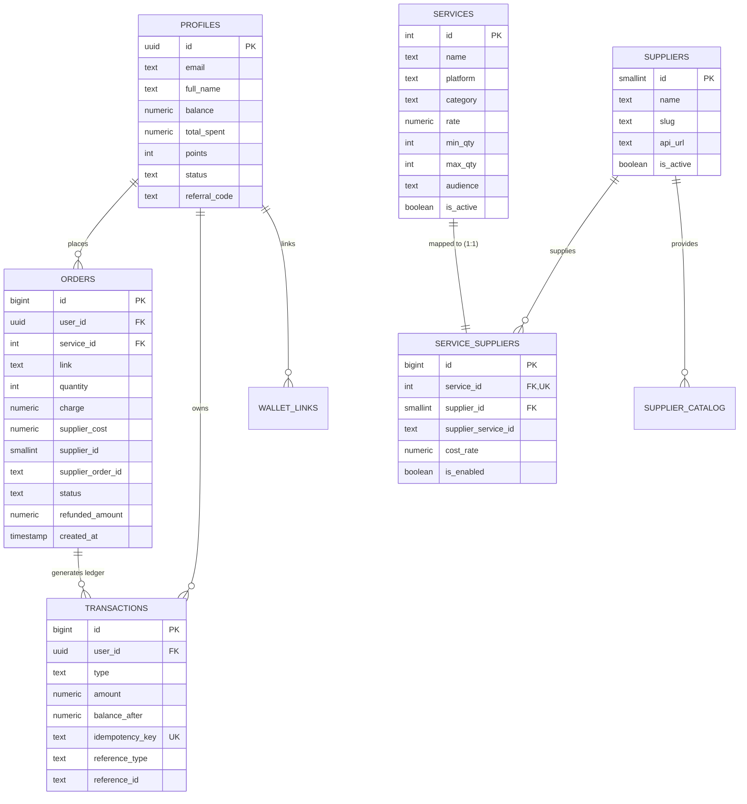
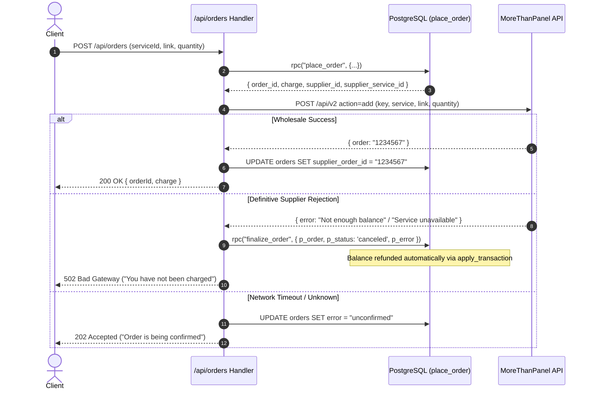

# LegitSMM Architecture Specification

This document details the architectural principles, database schema, transactional invariants, and wholesale routing design of the **LegitSMM** platform.

---

## 1. Architectural Principles

1. **Zero Client Trust:** All financial calculations, service retail rates, min/max quantities, and supplier assignments are resolved exclusively on the server and verified inside PostgreSQL stored procedures.
2. **Atomic Row-Level Locking:** All user balance mutations execute within PostgreSQL transactions guarded by `FOR UPDATE` row locks to prevent race conditions or double-spending attacks.
3. **Immutable Financial Ledger:** User balances are never updated directly by loose queries. Every balance credit, debit, or refund is recorded through `apply_transaction` with a unique idempotency key.
4. **Deterministic Single-Supplier Routing:** Each service in `public.services` is tied to exactly one primary wholesale supplier via `public.service_suppliers (UNIQUE (service_id))`.

---

## 2. Database Schema & Entity Relationships



---

## 3. Stored Procedures & Transaction Engine

### 3.1 `place_order`
Placed at `public.place_order(p_user uuid, p_service text, p_link text, p_quantity integer, p_extra jsonb)`:
1. Validates that the service exists and is active.
2. Validates link length and non-emptiness.
3. Checks that `p_quantity` falls strictly within `[min_qty, max_qty]`.
4. Retrieves the single hardcoded supplier from `service_suppliers` where `is_enabled = true`.
5. Acquires a pessimistic row lock on the user:
   ```sql
   select balance into v_balance from public.profiles where id = p_user for update;
   ```
6. If `v_balance < v_charge`, aborts immediately with `insufficient_balance`.
7. Inserts the order row into `public.orders` with `status = 'pending'`.
8. Calls `apply_transaction` to deduct `v_charge` and record an `order_charge` transaction ledger entry.
9. Returns `order_id`, `charge`, `supplier_id`, and `supplier_service_id`.

### 3.2 `finalize_order`
Placed at `public.finalize_order(p_order bigint, p_status text, p_start_count integer, p_remains integer, p_error text)`:
- Idempotently updates the order status to a final state (`completed`, `partial`, `canceled`).
- **Automated Refund Trigger:**
  - If `p_status = 'canceled'`, issues a **100% refund** of `orders.charge` back to `profiles.balance` via `apply_transaction(type = 'order_refund')`.
  - If `p_status = 'partial'`, computes a proportional refund:
    $$\text{Refund} = \text{round}\left(\text{charge} \times \frac{\min(\text{remains}, \text{quantity})}{\text{quantity}}, 6\right)$$
  - Records the exact refund amount on `orders.refunded_amount`.

### 3.3 `apply_transaction`
Atomic accounting function that applies balance changes and ensures that `transactions.idempotency_key` is strictly unique.

---

## 4. Wholesale Fulfillment & Refund Loop

When an order is created through `POST /api/orders`:



---

## 5. Asynchronous Status Polling

Background reconciliation runs via `/api/jobs/checkstatus`:
1. Triggered every 2-5 minutes by an Upstash QStash cron webhook.
2. Verified against `QSTASH_CURRENT_SIGNING_KEY` to prevent unauthenticated execution.
3. Batches open orders (`pending`, `in-progress`, `processing`) in groups of 100 per supplier.
4. Queries supplier `action=status` for batch order IDs.
5. Maps supplier statuses to LegitSMM statuses:
   - `Completed` $\rightarrow$ `completed`
   - `Processing` / `In progress` $\rightarrow$ `in-progress`
   - `Partial` $\rightarrow$ `partial` (with `remains` and partial refund)
   - `Canceled` $\rightarrow$ `canceled` (with full refund)
